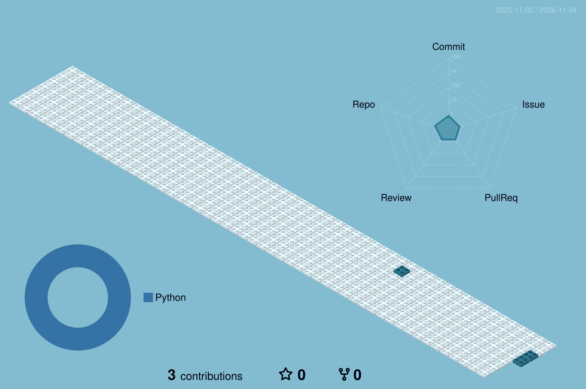
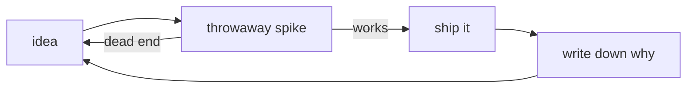

> [!NOTE]
> I build small things that work. Single binaries, zero dependencies, no tracking.
> If a repo here has a README that explains *why*, it shipped. If it doesn't, it's a draft.

<b>stack</b>

 

<b>stats</b>

 

 

 

<b>real ones ship.</b>

